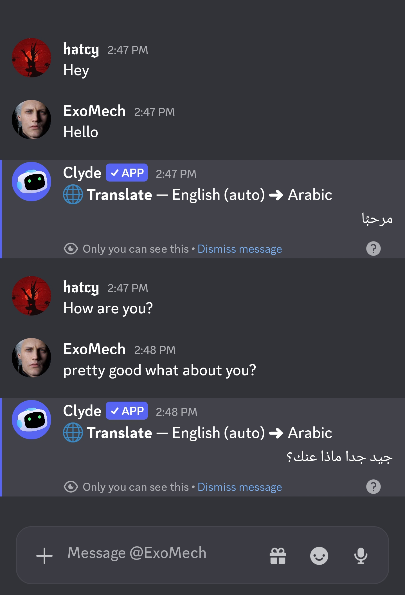
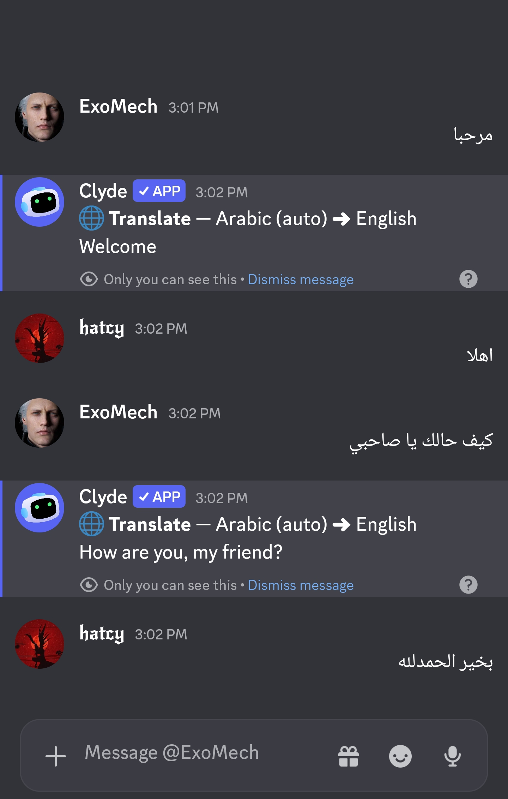
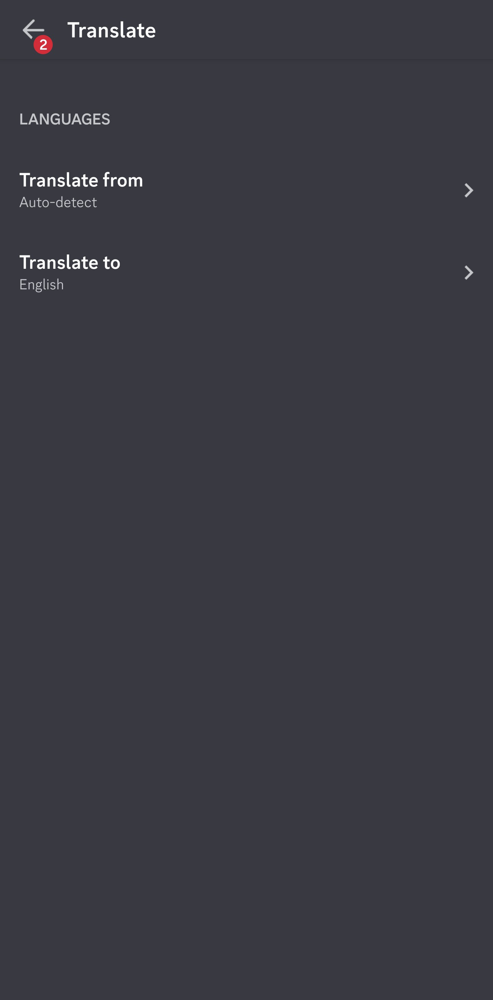
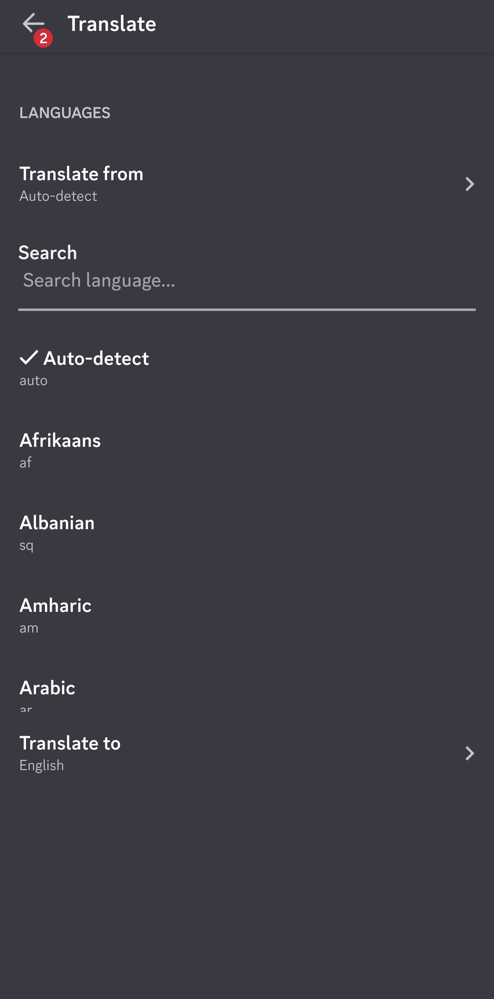
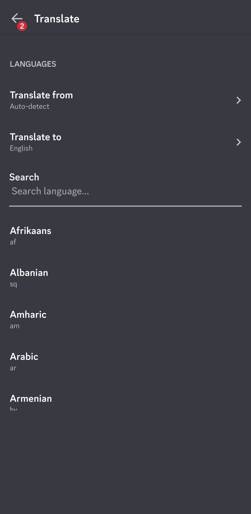

<div align="center">
# Under maintenance to convert it from Revenge to Valenced.
# ~~🌐 Hozy's Translator~~

**A lightweight, powerful Valenced plugin for Discord (Android)**  
*Seamlessly translate messages directly within your chat without switching apps.*

<br/>

[](https://discord.gg/jwpb9YdBJa)
[](#)
[](https://discord.gg/jwpb9YdBJa)
[-3DDC84?style=for-the-badge&logo=android&logoColor=white)](#)

<br/>

</div>

---

## 📖 What is this?

I built this translator plugin for the Valenced Discord client on Android because I was tired of switching apps just to read messages in other languages. This lets you translate everything directly inside your chat view.

---

## ✨ Features

- **Inline Translation:** Translates messages instantly without ever leaving Discord.
- **Seamless UI Integration:** Adds a simple "Translate" option straight into the native message context menu.
- **Lightweight:** Optimized for fast execution so it won't lag your client.

---

## 📸 Showcase

### Chat Translation
Seamlessly translate incoming and outgoing messages directly in the chat.

| English to Arabic | Arabic to English |
| :---: | :---: |
|  |  |

### Plugin Settings
Easily configure your translation preferences.

| Main Settings | Language Selection | Search & Auto-detect |
| :---: | :---: | :---: |
|  |  |  |

---

## 📥 Installation

To install this plugin in **Valenced** on Discord (Android):

1. Copy the plugin URL:
   ```text
   https://hshs-501.github.io/translate_plugin/
   ```
2. Open Discord and go to **User Settings** (your profile icon).
3. Scroll down to the **Valenced** section and tap **Plugins**.
4. Tap the **`+`** (Install Plugin) button at the top right.
5. Paste the plugin URL and confirm the install.
6. The plugin will load automatically. Enable the toggle and restart your app!

---

## 🛠️ How to Use

1. Open any server or direct message.
2. Long-press the message you want to translate.
3. Tap the **Translate** button in the context menu.

---

## 👤 Author & Community

- **Developer**: **HsHs-501**
- **Discord User**: `.95.4`
- **Discord Server**: [Join Server](https://discord.gg/jwpb9YdBJa)

---

<div align="center">
<sub>Built with ❤️ for the Valenced Discord Community</sub>
</div>
